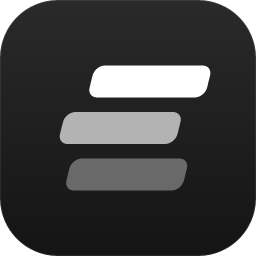
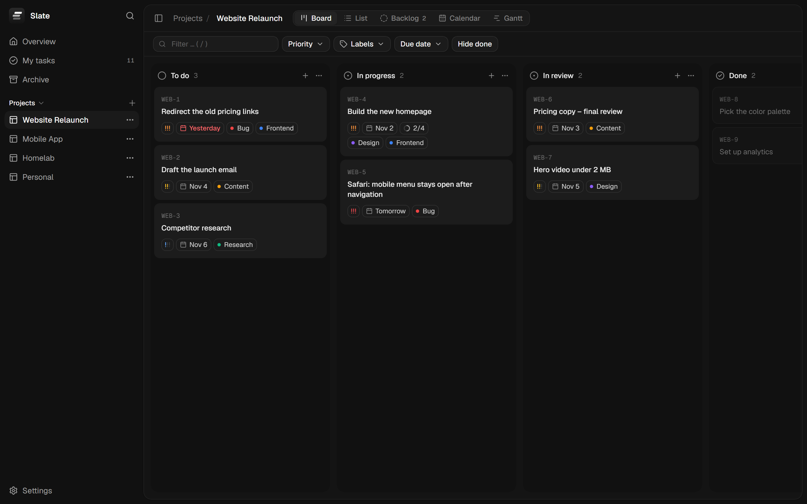
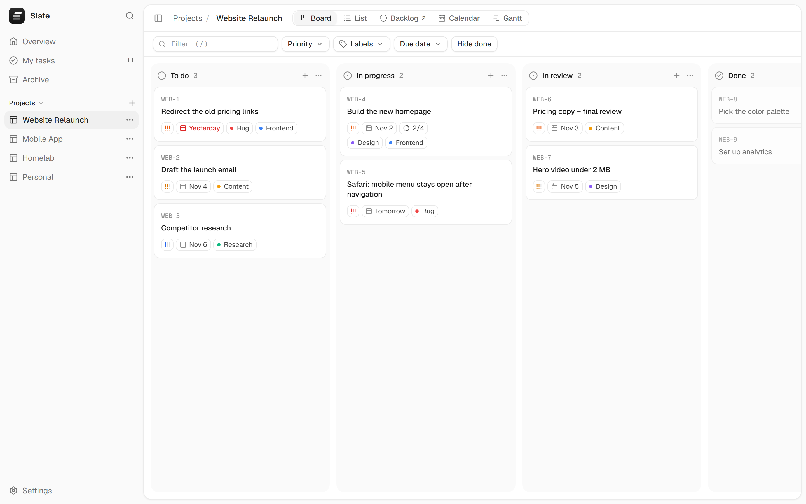
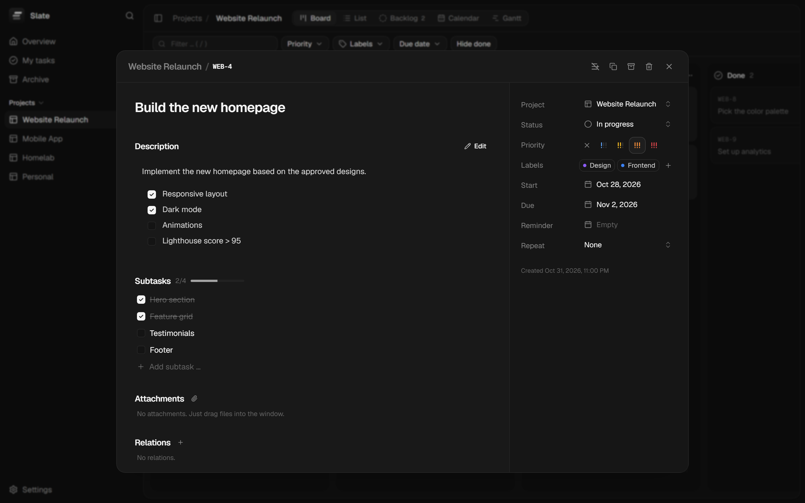
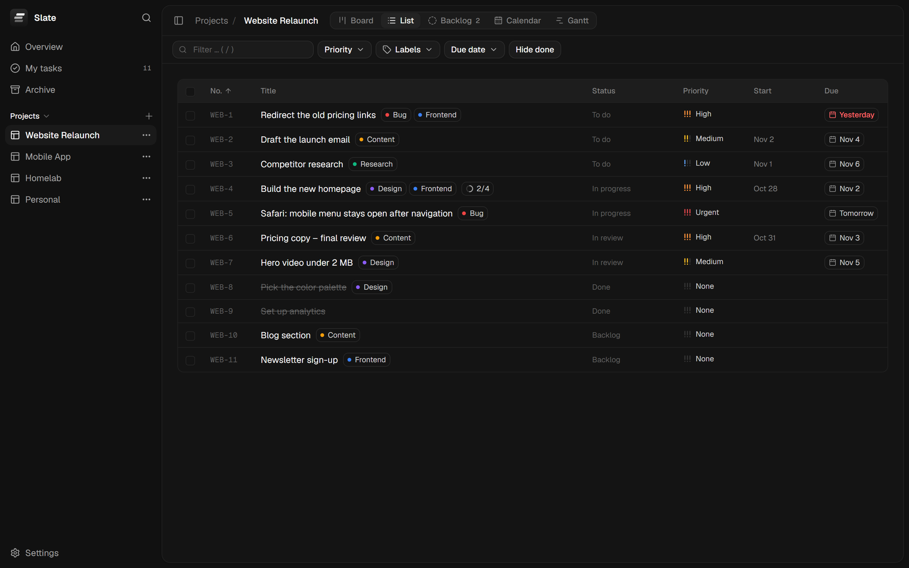
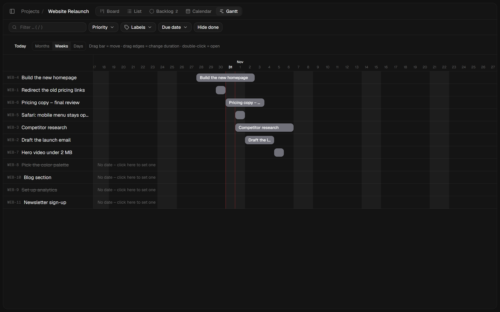
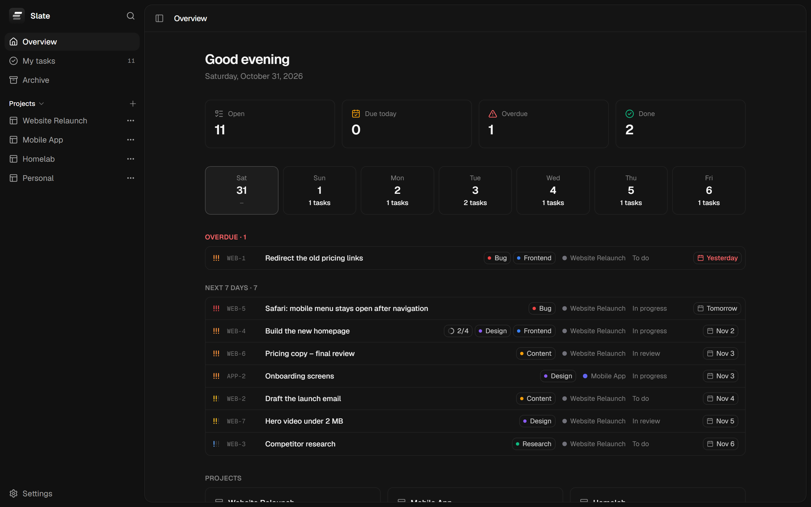
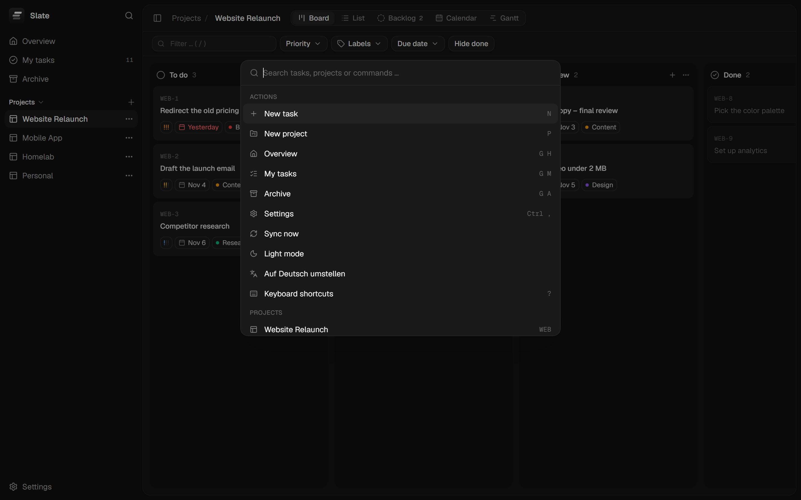

<p align="center">
  
</p>

<h1 align="center">Slate</h1>

<p align="center">
  A fast, minimal project manager for your desktop.<br />
  No accounts, no server, no clutter – your tasks live on your own computer.
</p>

<p align="center">
  <a href="https://github.com/ItsDylan255/Slate/releases/latest"><strong>Download for Windows</strong></a>
</p>

<p align="center">
  
</p>

## Why Slate?

Most project managers are web apps packed with features you will never use. Slate is a native desktop app that focuses on what matters for personal projects: a clean Kanban board, tasks with the details you actually need, and a few smart extras. Its look is inspired by [Kaneo](https://github.com/usekaneo/kaneo).

- **Local first** – everything is stored in a SQLite database on your PC. Works completely offline.
- **Small and fast** – a ~4 MB installer, starts instantly, uses very little memory (built with [Tauri](https://tauri.app)).
- **Sync via Google Drive** – optional, through the Google Drive for desktop folder. No extra account or server.
- **Google Calendar** – optional, dated tasks appear as events in a dedicated “Slate” calendar.
- **German and English** – switch any time in the settings.

## Features

### Views

| Board | Task details |
|---|---|
|  |  |
| **List** | **Gantt** |
|  |  |
| **Overview** | **Command palette** |
|  |  |

- **Board** with drag & drop for cards and columns, four default columns (To do, In progress, In review, Done)
- **List**, **Backlog**, **Calendar** and **Gantt** (drag bars to move, drag edges to change duration)
- **Overview** with what is due today, overdue and this week, plus project progress
- **My tasks** across all projects, grouped by due date
- **Archive** for finished tasks and projects

### Tasks

- Task numbers per project (e.g. `WEB-12`), priority, start date, due date and reminders
- Markdown description with clickable checklists
- Subtasks, labels, file attachments (just drag files into the window), links and relations (“blocks”, “relates to”, “duplicates”)
- Recurring tasks – when you complete one, the next one is created automatically
- Custom fields per project (text, number, date, select, yes/no)
- Change history
- “Create more” mode to add several tasks in a row

### Productivity

- **Command palette** (`Ctrl+K`) to find tasks and projects and run actions
- Keyboard shortcuts for almost everything (`?` shows them all)
- Multi-select with `Ctrl`/`Shift`+click and bulk actions, right-click context menu
- Filters by text, priority, labels and due date
- Collapsible sidebar (`Ctrl+B`), light and dark mode

### Your data

- **Automatic backups** – Slate always keeps exactly four: from the last day, the last 3 days, the last week and the last month. Restore any of them with one click.
- Manual backup and import (JSON), export to CSV (Excel) and iCal (`.ics`)
- Windows notifications for reminders and a daily summary
- Optional: start with Windows (minimized to the tray) and minimize to the tray when closing, so reminders and sync keep running

## Installation

1. Download **`Slate_1.0.1_x64-setup.exe`** from the [latest release](https://github.com/ItsDylan255/Slate/releases/latest).
2. Run it. Windows SmartScreen may show *“Windows protected your PC”* because the app is not code-signed – click **More info → Run anyway**.
3. Slate installs for your user (no admin rights needed) and adds a Start menu entry.

**Updating:** Slate checks GitHub for new versions automatically and shows *“Update to …”* in the sidebar – one click installs it and restarts the app. You can also check manually in *Settings → General*. Your data is always kept. (Version 1.0.0 has no updater yet – install 1.0.1 once by hand.)
**Uninstalling:** *Windows Settings → Apps → Slate*. Your data stays in `%APPDATA%\com.dylan.projektmanager\` unless you delete it.

An `.msi` package is available as well.

## Sync between PCs (Google Drive)

1. Install [Google Drive for desktop](https://www.google.com/drive/download/) and sign in.
2. In Slate open **Settings → Google Drive sync**. Slate detects your Drive folder automatically (`…\My Drive\Slate`). Enable sync.
3. On your other PC: install Slate, choose the same folder and enable sync.

Each PC only writes its own file, so Google Drive never sees conflicting edits. If the same task was changed on two PCs, the newer change wins.

## Google Calendar

Slate can keep a dedicated **“Slate”** calendar in your Google account up to date. Every task with a date becomes an all-day event (a task with a start and due date spans those days). Done tasks get a ✓, deleted or archived tasks disappear. Your other calendars are never touched.

Because Slate has no server, it uses your own free Google Cloud project for the sign-in. The one-time setup takes about 10 minutes and is explained step by step in **Settings → Google Calendar**:

1. Create a project in the [Google Cloud Console](https://console.cloud.google.com/) and enable the **Google Calendar API**.
2. Configure the OAuth consent screen (audience “External”), add a homepage and privacy policy link on the *Branding* page, then **publish** the app.
3. Create an OAuth client of type **Desktop app** and paste the client ID and secret into Slate.
4. Click **Connect with Google**. Google shows “This app isn’t verified” for personal apps – choose **Advanced → Go to Slate**.

See the [privacy policy](PRIVACY.md) for what Slate does with your Google data (in short: nothing leaves your computer except the calendar events themselves).

## Building from source

Requirements: [Node.js](https://nodejs.org) (LTS), [Rust](https://rustup.rs) and, on Windows, the [Microsoft C++ Build Tools](https://visualstudio.microsoft.com/visual-cpp-build-tools/) (“Desktop development with C++”).

```bash
npm install          # install dependencies (once)
npm run tauri dev    # run the desktop app in development mode
npm run tauri build  # build the installers -> src-tauri/target/release/bundle/
npm run dev          # UI only, in the browser with an in-memory test database
```

**Releases with auto-update:** set `TAURI_SIGNING_PRIVATE_KEY` (path to the updater key) before `npm run tauri build`, then run `node scripts/latest-json.mjs "notes"` and upload the setup `.exe` and `latest.json` to the GitHub release. The updater only accepts builds signed with this key.

Opening `http://localhost:1420/?demo&lang=en` in dev mode fills the browser version with sample data (used for the screenshots above).

### Project structure

| Path | Contents |
|---|---|
| `src-tauri/src/lib.rs` | Rust side: database migrations, file access, Google sign-in, single instance |
| `src-tauri/migrations/` | Database schema (SQL) |
| `src/store.ts` | All data and actions (create, update, delete, recurrence, history) |
| `src/lib/` | Sync, backups, Google Calendar, export, reminders, shortcuts |
| `src/views/` | Overview, My tasks, Board, List, Backlog, Calendar, Gantt, Archive |
| `src/components/` | Sidebar, task window, dialogs, UI building blocks |
| `src/i18n/` | German and English texts |
| `src/dev/` | Browser test environment and demo data (not part of the app) |

**Tech stack:** Tauri 2 · React 19 · TypeScript · Tailwind CSS 4 · dnd-kit · zustand · SQLite

## Credits

- Design inspired by [Kaneo](https://github.com/usekaneo/kaneo) (MIT license) – color tokens and component styles are modeled on it.
- Font: [Geist](https://vercel.com/font) by Vercel.
- Icons: [Lucide](https://lucide.dev).
